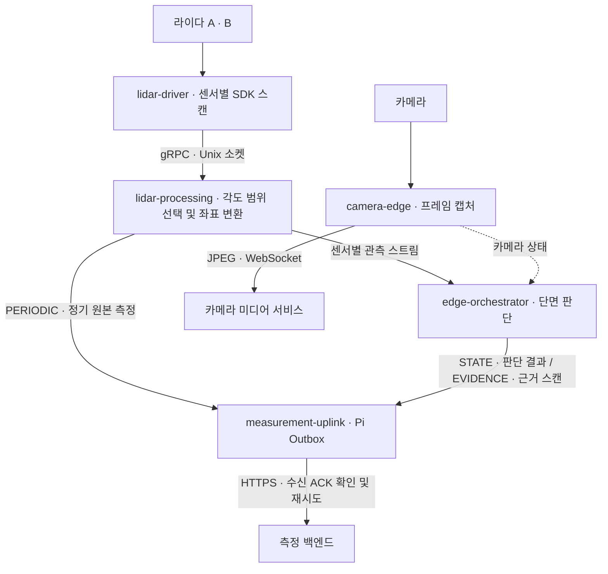

# Ajin Edge Platform

스크랩 적재함 상단에서 비스듬히 내려다보는 두 대의 2D 라이다로 **서로 다른 두 단면의 적재 높이와 면적비**를 추정한다. Raspberry Pi에서 SLAMTEC SDK로 스캔을 수집하고, Python 서비스가 좌표 변환부터 단면 계산, 근거 스캔 보관과 전송까지 수행한다.

이 저장소의 구현 범위는 라이다 드라이버·전처리, 카메라 캡처·송출, 판단 오케스트레이션, 측정 전송이다. 영상 수신·녹화는 별도 [카메라 미디어 서비스](https://github.com/ajin-scrap-monitoring/ajin-camera-media-service)가 담당하고, 측정 백엔드와 관제 화면은 다른 팀원의 연동 영역이다.

## 센서에서 서버까지



정기 원본은 **설정한 각도 범위에 들어온 점**의 인덱스·각도·거리·품질과 계산 가능한 XYZ를 보존한다. 오케스트레이터는 이 관측으로 다음 두 결과를 별도로 만든다.

| 결과 | 계산 단위 | 출력의 의미 |
| --- | --- | --- |
| 점별 필터 XYZ | 각 센서의 최신 스캔에 있는 점 하나 | 품질·거리·주변 광선과의 편차를 검사하고, 과거 스캔에서 각도가 대응하는 유효 거리들의 중앙값으로 XYZ를 계산한다. 유효하지 않은 점도 배열 위치를 유지하고 `null`과 사유를 보낸다. |
| 단면 프로필과 종합 적재율 | 센서별 수평 구간(bin), 이후 A/B 종합 | 구간별 바닥 기준 높이를 구하고 각 단면의 적재 면적비를 계산한다. 종합값에는 두 단면의 보정곡선과 가중치를 적용한다. |

## 사선 거리에서 적재율까지

**1. 반사점을 적재함 좌표로 옮긴다.** 거리 $r$은 센서에서 반사점까지의 사선 길이(mm)다. 센서 각도에 설치 방향 부호와 영점 오프셋을 적용해 라디안 $\theta$를 얻는다. 센서 평면의 점에 설치 회전행렬 $R$과 설치 위치 $t$를 적용하면 적재함 좌표의 높이 $z$를 얻을 수 있다.

$$
p_{\mathrm{local}}=(r\cos\theta,\ r\sin\theta,\ 0)^T,\qquad
(x,y,z)^T=R\,p_{\mathrm{local}}+t
$$

**2. 센서마다 독립된 높이 프로필을 만든다.** 단면의 수평 원점 $o$, 단위 방향 $u$, 구간 폭 $\Delta s$를 두고, 점의 구간 번호를 $i=\lfloor ((x,y)-o)\cdot u/\Delta s\rfloor$로 구한다. 품질·거리·높이 범위를 통과한 점끼리 같은 스캔·같은 구간에서 $z$의 중앙값을 취한다. 이웃 구간에 비해 튀는 값은 제외하고, 같은 구간의 여러 스캔에 다시 중앙값을 적용한다.

양옆에 관측값이 있는 짧은 공백만 $z$를 선형 보간하고 출처를 `INTERPOLATED`로 기록한다. 구간 바닥과 상한을 $f_i,c_i$라 하면 대표 높이는 $h_i=\min(c_i-f_i,\max(0,\hat z_i-f_i))$이다. 활성 구간에 끝까지 높이가 비면 단면 면적비를 `null`로 두므로, 미관측 구간과 실제 높이 0mm를 구별할 수 있다.

**3. 두 단면의 면적비를 종합한다.** 센서 $s$의 활성 구간 집합 $I_s$에 대해 수직 투영 단면에서 차지한 면적을 전체 용량 면적으로 나눈다. 각 면적비에 센서별 구간 선형 보정곡선 $g_s$를 적용하고 가중치 $w_s$로 평균한다.

$$
q_s=\frac{\sum_{i\in I_s}\Delta s\,h_i}{\sum_{i\in I_s}\Delta s\,(c_i-f_i)},\qquad
\hat q=\frac{w_A g_A(q_A)+w_B g_B(q_B)}{w_A+w_B}
$$

예를 들어 A 단면이 40%, B 단면이 60%이고 항등 보정곡선과 동일 가중치를 사용하면 종합 추정값은 50%다. 이 수치는 두 단면이 적재함 전체를 얼마나 잘 대표하는지에 의존한다. 시뮬레이터 기본 설정에서는 비율을 계산해도 판단에 `LIMITED / DEFAULT_SETTINGS`를 함께 표시한다. 현장 적재량에 대한 정확도는 실측 검증 항목이다.

**시간 정합.** 2026-11-17 Pi 검증 설정은 최근 최대 5스캔, 구간별 최소 3개 유효 스캔, 유효기간 1초였다. 1초 판단 주기에서 A/B 최신 스캔의 단조 시계 기준 차이가 100ms를 넘으면 새 관측을 최대 300ms 기다린다. 검사한 입력을 그대로 계산에 넘기고, 시간 차이가 계속 크면 개별 단면 결과와 시간 불일치 사유를 남기며 종합값을 보류한다.

[좌표 변환 구현](packages/edge-common/src/ajin_edge/v2/processing.py) · [점별 거리 필터](packages/edge-common/src/ajin_edge/v2/point_cloud.py) · [구간·높이·면적 계산](packages/edge-common/src/ajin_edge/v2/section_profile.py) · [두 단면의 종합 판단](packages/edge-common/src/ajin_edge/v2/judgment.py)

## 버전 구분

| 구분 | 버전 | 식별 대상 |
| --- | --- | --- |
| 게시된 Docker 릴리스 | `v0.1.0`, `v0.1.1` | 초기 이미지 게시 이후 `v0.1.1`에서 ARM64 이미지 5종과 digest로 고정한 배포 참조 파일을 함께 제공했다. |
| 이 문서의 Docker 릴리스 기준 | `v1.0.0` | 위 계산·전송 흐름을 담은 버전이다. 발행된 태그와 이미지 digest는 [GitHub Releases](https://github.com/ajin-scrap-monitoring/ajin-edge-platform/releases)에서 확인한다. |
| 측정·판단 메시지 규격 | `schema_version: "2.0"` | 수신 측이 해석할 JSON 필드와 구조를 식별한다. |
| 설정·알고리즘 | `config_revision`, `calibration_version`, `method_version` | 각각 적용된 설정 묶음, 센서의 설치 변환, 판단 계산 방법을 식별한다. 같은 소프트웨어 릴리스에서도 현장 설정을 갱신할 수 있다. |

[릴리스 절차와 이미지 구성](docs/RELEASE.md)

## 문서

- [전체 아키텍처와 남은 구성 요소](docs/ARCHITECTURE.md)
- [배포·장애 복구·현장 인수](docs/OPERATIONS.md)
- [백엔드·영상 연동 계약](docs/BACKEND_CONTRACT.md)
- [전체 점별 필터 XYZ 수신 규격·합성 JSON 예제](docs/FILTERED_POINT_CLOUD_CONTRACT.md)
- [점별 XYZ의 Pi Docker·실제 입력 검증](docs/FILTERED_POINT_CLOUD_VALIDATION_2026-11-10.md)
- [검증 기록](docs/VALIDATION.md)
- [설계 결정과 한계](docs/IMPLEMENTATION_DECISIONS.md)
- [Pi 라이다 보정 수신 API](docs/CALIBRATION_API.md)
- [Pi 설치·단면·곡선·가중치 통합 설정 API](docs/CONFIGURATION_API.md)
- [Pi 주기·보정 API 검증과 지연 한계](docs/PI_PIPELINE_CALIBRATION_VALIDATION_2026-11-08.md)

## 실제 디렉터리

```text
services/
  lidar-driver/             C++ SDK 소스·테스트·CMake·Dockerfile
  lidar-processing/         src/ajin_lidar_processing + Dockerfile
  measurement-uplink/       src/ajin_measurement_uplink + Dockerfile
  camera-edge/              독립 Python 프로젝트·테스트·Dockerfile
  edge-orchestrator/        src/ajin_edge_orchestrator + Dockerfile
packages/edge-common/       src/ajin_edge: 공통 계약·상태·설정·시간·HTTPS
contracts/                 Proto / 백엔드 JSON Schema 원본
deploy/                    Pi Compose / 환경·보정 예제 / clock systemd
tests/                     라이다·전달·오케스트레이터·공통 회귀
integration-tests/         실제 로컬 gRPC / 합성 리플레이
tools/                     계약 생성 / 시각 exporter / runtime 준비
docs/                      설계·운영·검증·남은 작업
```

Python 서비스 세 개와 공통 코드는 루트 `pyproject.toml`/`uv.lock`으로 함께 패키징한다.
각 서비스의 실제 코드는 자기 폴더에 있지만 **각각 독립 프로세스·이미지로 실행**한다.
카메라는 PyAV 의존성을 격리하기 위해 `services/camera-edge`의 독립 pyproject/lock을 유지한다.

## 빠른 시작

아래는 저장소 루트 기준이며 Python 3.13과 uv가 필요하다.

```shell
uv sync --frozen --python 3.13
uv run --frozen pytest -q
uv run --frozen edge-replay --config deploy/config.example/processing.example.json --input integration-tests/replay-data/half-full-then-loss.jsonl --allow-demo
```

카메라 자체 환경은 `cd services/camera-edge` 후 `uv sync --frozen --extra dev`로 준비한다.
카메라 테스트는 하드웨어 캡처 성공을 뜻하지 않는다.

위 명령은 기존 `edge-replay` 경로의 합성 테스트다. 약 50% 결과 뒤 두 센서 단절 시
`INVALID`와 적재율 필드 생략을 확인한다. `--allow-demo` 없이는 예제 보정을 거부한다.
데모 보정을 운영값으로 바꾸거나 리플레이 데이터를 운영 Uplink에 넣으면 안 된다.

## 빌드·배포 경계

라이다/전달/오케스트레이터 Docker 빌드 context는 이 저장소 루트이고, 카메라는 자기 서비스
폴더가 context다. 정확한 명령과 secret·권한 준비는 [OPERATIONS](docs/OPERATIONS.md)에 있다.
Compose는 이미지 조합을 실행할 뿐 현장 설정이나 인증정보를 생성하지 않는다.

## 이용 조건

이 Repository는 코드 검토와 참고를 위해 Public으로 제공하며 프로젝트 소스 코드에 별도 라이선스를 부여하지 않는다.
외부 라이브러리에는 각 라이선스가 적용되며 SLAMTEC SDK 고지는 `services/lidar-driver/NOTICE`에 있다.

이 README의 설명, 수식 정리 및 워크플로 다이어그램 작성에 생성형 AI를 사용했다.
